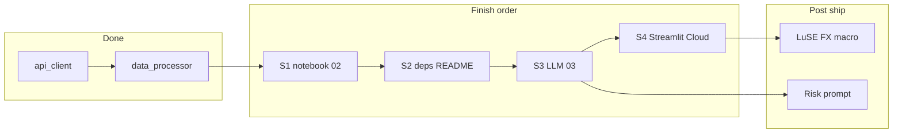

# Investant — plan to finish (updated)

## Strategic stance (do not pivot now)

- **Ship Investant first.** Strong `src/` without runnable notebooks is invisible on a profile; reproducible `02` + narrative is the gap.
- **No SQL/dbt warehouse demo in this phase** — treat as a **separate project** (e.g. month 3–4) once Investant is live. Modular Python already signals analytics-engineering habits.
- **No supervised forecasting / LSTMs / RNNs here** — right depth for Data Analyst → Analytics Engineer targets is **k-means + PCA** plus pipeline + LLM. Heavier ML belongs in a **second repo** if needed later.
- **Investment Management angle:** frame clustering as **market regime identification** (how PMs bucket risk/return styles). Interpret clusters in business language—that is the differentiator vs generic k-means demos.

## Product vision (after core wiring)

- **Core:** Identify clusters from OHLCV-derived features; label with existing `label_clusters_by_centers` strings.
- **User-facing stretch:** **Risk profiling** — e.g. conservative → emphasize `firmer_trend_moderate_volatility`; balanced → moderate + firmer high vol; aggressive → higher-vol labels—with **disclaimers** and no buy/sell claims. Implementation: add **risk profile (and later LuSE/FX context) to the LLM system/user prompt**; `build_llm_payload` already carries `cluster_label` per stock. **Day-3+ after** `02` + `03` baseline (notebook `02` can include a **preview cell** mapping profiles → tickers from `payload["stocks"]`).

## Post-MVP enrichment (does not block shipping)

- **LuSE (Zambia):** manually downloaded CSVs into `data/raw`, same schema as today.
- **Context layer:** ZMW/ZAR/USD and macro notes in README / `universe_note` / LLM prompt for **African retail investor** story.
- **CV / README one-liner** (use once narrative matches data—LuSE line is aspirational until files exist):

> Built Investant — an end-to-end equity analytics pipeline processing JSE, LuSE (Zambia), and US OHLCV through modular Python (`src/`), k-means for **market regime** identification, PCA for visualization, and Claude for narrative analysis contextualised for the African retail investor (FX and macro where applicable). Deployed on Streamlit Cloud.

Until LuSE is in repo, shorten to JSE + US only to stay truthful.

---

## Where things stand

| Area                                                                                                                              | Status                                                                          |
| --------------------------------------------------------------------------------------------------------------------------------- | ------------------------------------------------------------------------------- |
| [src/data_processor.py](C:\Users\Simba\OneDrive\Desktop\Data Analytics\Investant\src\data_processor.py)                           | Complete pipeline: load → align → returns → snapshot → labels → payload + blurb |
| [notebooks/02_analysis_ml.ipynb](C:\Users\Simba\OneDrive\Desktop\Data Analytics\Investant\notebooks\02_analysis_ml.ipynb)         | **Stub** — highest priority                                                     |
| [notebooks/03_llm_integration.ipynb](C:\Users\Simba\OneDrive\Desktop\Data Analytics\Investant\notebooks\03_llm_integration.ipynb) | **Stub**                                                                        |
| [src/llm_assistant.py](C:\Users\Simba\OneDrive\Desktop\Data Analytics\Investant\src\llm_assistant.py)                             | Placeholder                                                                     |
| [app/streamlit_app.py](C:\Users\Simba\OneDrive\Desktop\Data Analytics\Investant\app\streamlit_app.py)                             | Placeholder                                                                     |
| README / requirements                                                                                                             | Thin                                                                            |

**Rough timeline:** ~**four focused sessions** (about 2–3 hours each)—end-to-end shareable Investant by end of following week if sessions are protected.

---

## Session 1 — `02_analysis_ml.ipynb` (cell blueprint)

Run top-to-bottom from `data/raw`. Use `**WINDOW**`, `**N_CLUSTERS**` (e.g. 2 for small universe; increase with more names), `**random_state=42**`, `**n_init=10**`.

| Cell | Purpose                                                                                                                                                                                            |
| ---- | -------------------------------------------------------------------------------------------------------------------------------------------------------------------------------------------------- |
| 1    | `sys.path`, `json`, `warnings`, pandas/numpy, matplotlib/seaborn, sklearn `StandardScaler`, `KMeans`, `PCA`; import all `data_processor` helpers listed below; style + success print               |
| 2    | `load_stocks_from_raw_dir()` → `align_closes` → print shape, date range, `head`                                                                                                                    |
| 3    | `daily_returns_pct` → `**dropna()**` on first row from `pct_change`; `describe`                                                                                                                    |
| 4    | `snapshot_features_for_clustering(returns, window=WINDOW)`; print feature matrix                                                                                                                   |
| 5    | Scale features → `KMeans` → `cluster_series` (`pd.Series` indexed like `feature_df.index`)                                                                                                         |
| 6    | `label_clusters_by_centers(feature_df, cluster_series, kmeans.cluster_centers_)`; print id → label → members                                                                                       |
| 7    | `PCA(n_components=2)` on **same scaled matrix**; scatter PC1 vs PC2, colored by cluster, annotate tickers; print explained variance; save e.g. `data/cluster_pca.png` (ensure parent dir exists)   |
| 8    | Results table: features + `cluster_id` + `cluster_label`                                                                                                                                           |
| 9    | `as_of` from `closes.index.max()`, `classifier_note` (educational / not advice), `build_llm_payload` + `build_narrative_blurb`, print JSON + blurb, `**json.dump` → `data/payload.json`** for `03` |
| 10   | **Risk profile preview:** dict mapping conservative / balanced / aggressive → allowed `cluster_label` strings; filter `payload["stocks"]` to list tickers (no LLM call yet)                        |

Imports from `src.data_processor`:

`load_stocks_from_raw_dir`, `align_closes`, `daily_returns_pct`, `snapshot_features_for_clustering`, `label_clusters_by_centers`, `build_llm_payload`, `build_narrative_blurb`.

**Convention:** k-means on **scaled** original features; PCA for **visualization** (same scaled input). Title copy can say “African + US” only when universe matches; otherwise neutral “Market stocks …”.

---

## Session 2 — Reproducibility

- Add [requirements.txt](C:\Users\Simba\OneDrive\Desktop\Data Analytics\Investant\requirements.txt): pandas, numpy, scikit-learn, matplotlib, seaborn, jupyter/ipykernel, streamlit, python-dotenv, **anthropic** (for session 3), plus any deps required by [api_client.py](C:\Users\Simba\OneDrive\Desktop\Data Analytics\Investant\src\api_client.py) (e.g. `requests`).
- Update [README.md](C:\Users\Simba\OneDrive\Desktop\Data Analytics\Investant\README.md): venv, `pip install -r requirements.txt`, **run order** (`01` optional fetch → `02` from cache → `03`), short **data dictionary**, educational disclaimer, opening **project one-liner** (truthful scope), link to Streamlit after session 4.

---

## Session 3 — LLM

- Implement [src/llm_assistant.py](C:\Users\Simba\OneDrive\Desktop\Data Analytics\Investant\src\llm_assistant.py) `ask()` using **Anthropic SDK** + `python-dotenv` (key in `.env`, not committed).
- [notebooks/03_llm_integration.ipynb](C:\Users\Simba\OneDrive\Desktop\Data Analytics\Investant\notebooks\03_llm_integration.ipynb): load `data/payload.json`, attach blurb or JSON as context, system instructions: **do not invent numbers**; educational only.
- **Follow-up (todo `risk-profile-llm`):** optional parameter for user risk posture and mapping instructions to cluster labels.

---

## Session 4 — Streamlit + deploy

- [app/streamlit_app.py](C:\Users\Simba\OneDrive\Desktop\Data Analytics\Investant\app\streamlit_app.py): read `**data/payload.json`** (and show `cluster_pca.png` if present), display table / tabs; keep placeholders minimal.
- **Deploy to Streamlit Cloud**; add **live URL** to README and CV.

---

## Small code hygiene (any session)

- [data_processor.py](C:\Users\Simba\OneDrive\Desktop\Data Analytics\Investant\src\data_processor.py): typo “mata” → “matter”; optionally use or remove unused `centers` in `label_clusters_by_centers` so docstring matches.

---

## What “done” looks like

- Reviewer runs `02` from clean clone + venv + raw CSVs → clusters, PCA figure, `payload.json`.
- `03` calls Claude with saved payload.
- Streamlit demo + Cloud URL.
- README and one-liner match **actual** data universe (add LuSE sentence only when data exists).

